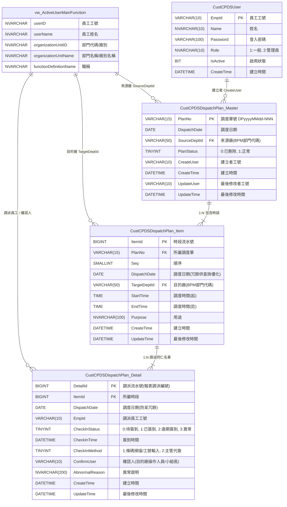

# 資料庫規劃規格書：跨廠人員調度與簽到系統 (CPDS)

**文件日期：** 2026-10-20  
**版本：** 2.0 (配合 index / checkin / report 頁面實際架構與使用者需求確認版)  
**目標系統：** Microsoft SQL Server 2016+ (LocalDB / BPMTEST / 正式 SQL Server)

---

## 1. 系統概述與設計架構 (v2.0 關鍵更新)

本文件依據前端三大核心畫面（`index.html` 調度排程、`checkin.html` 現場簽到、`report.html` 報表查詢）之欄位、排版與使用者業務規則確認進行全面重構：

1. **三層式調度業務結構**：
   - **主檔 (`Master`)**：各來源廠每日一張調度計畫單（日期、來源廠、狀態）。
   - **時段明細 (`Item`)**：單據下包含多筆調度時段（序號、目的廠、調度起訖時間、支援用途）。
   - **人員簽到明細 (`Detail`)**：每個時段指派多名同仁，並承載現場簽到狀態、實際簽到時間、確認人（小組長代簽/操作人）與異常說明。
2. **組織與廠別完全動態化**：
   - 廠別、部門、人員姓名與職稱，全面即時動態關聯 BPM 檢視表 `[vw_ActiveUserMainFunction]`，不另建多餘的實體靜態廠別表，透過 View `[vw_CPDS_Dept]` 提供下拉清單。
3. **同一同仁在同一天內僅能調度一次 (極致防呆原則)**：
   - **規則**：同一位同仁在同一天內**僅能被調派一次**（不論時段是否重疊）。
   - **實作**：在 `CustCPDSDispatchPlan_Detail` 冗餘調度日期 `DispatchDate`，並建立條件式唯一防呆索引（Filtered Unique Index: `(DispatchDate, EmpId) WHERE CheckInStatus <> 3`）。
   - **異常釋出機制**：當該員在現場因請假或特殊原因被標記為「3: 異常」時，條件式索引自動排除該筆紀錄，釋出該同仁額度，允許當日重新調派至其他緊急支援任務。
4. **現場簽到狀態與「已逾期」雙軌判定**：
   - **實體儲存狀態 (`CheckInStatus`)**：
     - `0`: 待簽到
     - `1`: 已簽到（於調度開始時間 10 分鐘內或調度時間前 10 分鐘簽到）
     - `2`: 逾期簽到（超過調度開始時間 10 分鐘以上 ~ 調度結束時間前完成簽到）
     - `3`: 異常（待簽到人員因請假、改派或其他原因被標記異常）
   - **動態推導狀態 (`DisplayStatus`)**：
     - `4`: **已逾期**（到調度結束時間前仍未簽到者，由檢視表依系統時間動態推導，不直接寫死於資料表，確保資料狀態具備時間實效性）。
5. **各廠每日單據唯一防呆**：
   - 主檔建立條件式唯一索引 `UQ_CustCPDSMaster_Date_SourceDept`（`WHERE PlanStatus = 1`），保證每個廠別在同一天僅能存在一張有效調度單。

---

## 2. 資料庫實體關聯模型 (ERD)



---

## 3. 資料表欄位詳細規格

### 3.1 系統帳密主檔 (`CustCPDSUser`)

- **功能說明**：儲存系統使用者身分認證資訊。
- **儲存引擎**：SQL Server 資料表

| 欄位名稱 | 資料型別 | 允許 NULL | 預設值 | 索引 / 約束 | 業務說明 |
| :--- | :--- | :---: | :---: | :---: | :--- |
| **`EmpId`** | `VARCHAR(10)` | 否 | - | **PK** (Clustered) | 員工工號（如 `JM30448`） |
| **`Name`** | `NVARCHAR(10)` | 否 | - | - | 員工姓名 |
| **`Password`** | `VARCHAR(100)` | 否 | - | - | 登入密碼雜湊/明文備援 |
| **`CreateTime`** | `DATETIME` | 否 | `GETDATE()` | - | 帳號建立時間 |
| **`IsActive`** | `BIT` | 否 | `1` | - | 是否啟用（1: 啟用, 0: 停用） |
| **`Role`** | `NVARCHAR(10)` | 否 | `N'1'` | - | 角色（1: 一般, 2: 管理員） |

---

### 3.2 調度計畫主檔 (`CustCPDSDispatchPlan_Master`)

- **功能說明**：記錄每日來源廠別之調度計畫單頭，對應 `index.html` 上半部清單。
- **儲存引擎**：SQL Server 資料表

| 欄位名稱 | 資料型別 | 允許 NULL | 預設值 | 索引 / 約束 | 業務說明 |
| :--- | :--- | :---: | :---: | :---: | :--- |
| **`PlanNo`** | `VARCHAR(15)` | 否 | - | **PK** (Clustered) | 調度單號（格式如 `DP20261016-001`） |
| **`DispatchDate`**| `DATE` | 否 | - | 複合條件唯一索引 | 調度日期 |
| **`SourceDeptId`**| `VARCHAR(50)` | 否 | - | 複合條件唯一索引 | 來源廠別代號（關聯 BPM 部門代碼） |
| **`PlanStatus`** | `TINYINT` | 否 | `1` | CHECK (0, 1) | 單據狀態：`0`: 已刪除（軟刪除）, `1`: 正常 |
| **`CreateUser`** | `VARCHAR(10)` | 否 | - | - | 建立者工號 |
| **`CreateTime`** | `DATETIME` | 否 | `GETDATE()` | - | 建立時間 |
| **`UpdateUser`** | `VARCHAR(10)` | 是 | NULL | - | 最後修改者工號 |
| **`UpdateTime`** | `DATETIME` | 是 | NULL | - | 最後修改時間 |

- **約束與索引**：
  - `UQ_CustCPDSMaster_Date_SourceDept`：`UNIQUE NONCLUSTERED (DispatchDate, SourceDeptId) WHERE PlanStatus = 1`，嚴格限制各廠每日僅能有一張正常調度單。

---

### 3.3 調度時段明細檔 (`CustCPDSDispatchPlan_Item`)

- **功能說明**：記錄單據下的各目的廠支援時段與用途，對應 `index.html` 下半部明細每一列。
- **儲存引擎**：SQL Server 資料表

| 欄位名稱 | 資料型別 | 允許 NULL | 預設值 | 索引 / 約束 | 業務說明 |
| :--- | :--- | :---: | :---: | :---: | :--- |
| **`ItemId`** | `BIGINT IDENTITY` | 否 | 自增 | **PK** (Clustered) | 時段明細主鍵流水號 |
| **`PlanNo`** | `VARCHAR(15)` | 否 | - | **FK** (CASCADE) | 所屬調度單號 |
| **`Seq`** | `SMALLINT` | 否 | - | UQ(PlanNo, Seq) | 單內順序編號（1, 2, 3...） |
| **`DispatchDate`**| `DATE` | 否 | - | NONCLUSTERED | 調度日期（同步自 Master，加速現場簽到拉單） |
| **`TargetDeptId`**| `VARCHAR(50)` | 否 | - | NONCLUSTERED | 目的廠別代號（關聯 BPM 部門代碼） |
| **`StartTime`** | `TIME(0)` | 否 | - | CHECK | 調度時間(起)（格式 `HH:mm`） |
| **`EndTime`** | `TIME(0)` | 否 | - | CHECK | 調度時間(訖)（格式 `HH:mm`） |
| **`Purpose`** | `NVARCHAR(100)` | 是 | NULL | - | 支援用途說明 |
| **`CreateTime`** | `DATETIME` | 否 | `GETDATE()` | - | 建立時間 |
| **`UpdateTime`** | `DATETIME` | 是 | NULL | - | 最後修改時間 |

- **約束與索引**：
  - `CK_CustCPDSItem_TimeRange`：`CHECK (StartTime < EndTime)`
  - `IX_CustCPDSItem_Date_TargetDept`：`NONCLUSTERED (DispatchDate, TargetDeptId) INCLUDE (PlanNo, StartTime, EndTime, Purpose)`

---

### 3.4 調派人員與現場簽到檔 (`CustCPDSDispatchPlan_Detail`)

- **功能說明**：記錄被指派同仁清單，並承載 `checkin.html` 現場點收、主管代簽及異常標記數據。
- **儲存引擎**：SQL Server 資料表

| 欄位名稱 | 資料型別 | 允許 NULL | 預設值 | 索引 / 約束 | 業務說明 |
| :--- | :--- | :---: | :---: | :---: | :--- |
| **`DetailId`** | `BIGINT IDENTITY` | 否 | 自增 | **PK** (Clustered) | 調派編號（對應報表調派編號） |
| **`ItemId`** | `BIGINT` | 否 | - | **FK** (CASCADE) | 所屬調度時段主鍵 |
| **`DispatchDate`**| `DATE` | 否 | - | 複合條件唯一防呆索引 | 調度日期（同步自 Item，用於同日單次調派防呆） |
| **`EmpId`** | `VARCHAR(10)` | 否 | - | 複合條件唯一防呆索引 | 被調派員工工號 |
| **`CheckInStatus`**| `TINYINT` | 否 | `0` | CHECK (0, 1, 2, 3) | 簽到狀態：<br>• `0`: 待簽到<br>• `1`: 已簽到<br>• `2`: 逾期簽到<br>• `3`: 異常 |
| **`CheckInTime`** | `DATETIME` | 是 | NULL | CHECK | 實際簽到時間 |
| **`CheckInMethod`**| `TINYINT` | 是 | NULL | CHECK (1, 2) | 簽到方式：<br>• `1`: 條碼掃描 / 手動工號輸入<br>• `2`: 主管代簽 |
| **`ConfirmUser`** | `VARCHAR(10)` | 是 | NULL | - | 確認人工號（簽到頁實際操作之目的廠小組長） |
| **`AbnormalReason`**| `NVARCHAR(200)`| 是 | NULL | - | 異常原因說明（如請假、機台故障換人等） |
| **`CreateTime`** | `DATETIME` | 否 | `GETDATE()` | - | 建立時間 |
| **`UpdateTime`** | `DATETIME` | 是 | NULL | - | 最後修改時間 |

- **約束與檢核**：
  - `UQ_CustCPDSDetail_DispatchDate_EmpId`：`UNIQUE NONCLUSTERED (DispatchDate, EmpId) WHERE CheckInStatus <> 3`。保證同一同仁在同一天內僅能調派一次（若標記為 3: 異常則排除，釋出額度）。
  - `CK_CustCPDSDetail_CheckInTime`：確保狀態為 1 或 2 時必須有簽到時間，0 或 3 時不得有簽到時間。
  - `IX_CustCPDSDetail_EmpId`：加速個人被指派衝突檢測與工號關鍵字查詢。

---

## 4. 業務邏輯防呆設計 (Constraints & Triggers)

### 4.1 同日單次調派唯一防呆索引 (`UQ_CustCPDSDetail_DispatchDate_EmpId`)

為落實「同一位同仁在同一天內目前僅能調度一次」的業務規範，並具備「異常退回釋出額度」的彈性機制：

```sql
CREATE UNIQUE NONCLUSTERED INDEX [UQ_CustCPDSDetail_DispatchDate_EmpId]
ON [dbo].[CustCPDSDispatchPlan_Detail] ([DispatchDate], [EmpId])
WHERE [CheckInStatus] <> 3;
```

> **機制解析**：
> - 只要 `CheckInStatus <> 3`（非異常退回），同一天 (`DispatchDate`) 同一員工 (`EmpId`) 只能存在一筆明細。
> - 若有新調度單欲排入同一同仁，資料庫將直接拋出 Unique Constraint 衝突例外，由資料庫引擎層級實現 100% 防呆，無並行併發（Concurrency）競態漏洞。
> - 當某員因故被標記為「3: 異常」時，條件式索引自動排除該筆紀錄，釋出額度允許當日重新調派至其他緊急支援任務。

### 4.2 調度時段明細檢核觸發程序 (`TR_CustCPDSItem_Validate`)

```sql
CREATE OR ALTER TRIGGER [dbo].[TR_CustCPDSItem_Validate]
ON [dbo].[CustCPDSDispatchPlan_Item]
AFTER INSERT, UPDATE
AS
BEGIN
    SET NOCOUNT ON;

    IF EXISTS (
        SELECT 1 FROM inserted i
        JOIN [dbo].[CustCPDSDispatchPlan_Master] m ON m.[PlanNo] = i.[PlanNo]
        WHERE i.[DispatchDate] <> m.[DispatchDate]
    )
    BEGIN
        RAISERROR(N'時段明細的調度日期必須與調度單主檔一致', 16, 1);
        ROLLBACK TRANSACTION; RETURN;
    END

    IF EXISTS (
        SELECT 1 FROM inserted i
        JOIN [dbo].[CustCPDSDispatchPlan_Master] m ON m.[PlanNo] = i.[PlanNo]
        WHERE i.[TargetDeptId] = m.[SourceDeptId]
    )
    BEGIN
        RAISERROR(N'「來源廠」與「目的廠」不可相同', 16, 1);
        ROLLBACK TRANSACTION; RETURN;
    END
END;
```

---

## 5. 整合檢視表與查詢設計

### 5.1 廠別/部門清單檢視表 (`vw_CPDS_Dept`)

直接聚合 BPM 組織視圖，提供前端來源廠與目的廠下拉選單：

```sql
CREATE OR ALTER VIEW [dbo].[vw_CPDS_Dept] AS
SELECT [organizationUnitID]        AS [DeptId],
       MAX([organizationUnitName]) AS [DeptName]
FROM [dbo].[vw_ActiveUserMainFunction]
WHERE [organizationUnitID] IS NOT NULL
GROUP BY [organizationUnitID];
```

### 5.2 跨廠調派全域整合檢視表 (`vw_CPDS_DispatchDetail`)

整合 Master、Item、Detail 與 BPM 使用者資料，並由 SQL 引擎以動態計算輸出 `DisplayStatus`（0:待簽到、1:已簽到、2:逾期簽到、3:異常、4:已逾期）：

```sql
CREATE OR ALTER VIEW [dbo].[vw_CPDS_DispatchDetail] AS
SELECT
    d.[DetailId],
    m.[PlanNo],
    i.[ItemId],
    i.[Seq],
    i.[DispatchDate],
    m.[SourceDeptId],
    sd.[DeptName]                       AS [SourceDeptName],
    i.[TargetDeptId],
    td.[DeptName]                       AS [TargetDeptName],
    i.[StartTime],
    i.[EndTime],
    i.[Purpose],
    d.[EmpId],
    emp.[userName]                      AS [EmpName],
    emp.[functionDefinitionName]        AS [EmpTitle],
    d.[CheckInStatus],
    -- 動態逾期判定：未簽到 (0) 且當前系統時間已超過調度結束時間者顯示為 4 (已逾期)
    CASE
        WHEN d.[CheckInStatus] = 0
         AND GETDATE() > CAST(i.[DispatchDate] AS DATETIME) + CAST(i.[EndTime] AS DATETIME)
        THEN 4
        ELSE d.[CheckInStatus]
    END                                 AS [DisplayStatus],
    CASE
        WHEN d.[CheckInStatus] = 0
         AND GETDATE() > CAST(i.[DispatchDate] AS DATETIME) + CAST(i.[EndTime] AS DATETIME)
        THEN N'已逾期'
        WHEN d.[CheckInStatus] = 0 THEN N'待簽到'
        WHEN d.[CheckInStatus] = 1 THEN N'已簽到'
        WHEN d.[CheckInStatus] = 2 THEN N'逾期簽到'
        WHEN d.[CheckInStatus] = 3 THEN N'異常'
        ELSE N'未知'
    END                                 AS [DisplayStatusName],
    d.[CheckInTime],
    d.[CheckInMethod],
    d.[ConfirmUser],
    cu.[userName]                       AS [ConfirmUserName],
    d.[AbnormalReason],
    m.[CreateUser]                      AS [PlanCreateUser],
    d.[CreateTime],
    d.[UpdateTime]
FROM [dbo].[CustCPDSDispatchPlan_Detail] d
INNER JOIN [dbo].[CustCPDSDispatchPlan_Item]   i ON i.[ItemId] = d.[ItemId]
INNER JOIN [dbo].[CustCPDSDispatchPlan_Master] m ON m.[PlanNo] = i.[PlanNo] AND m.[PlanStatus] = 1
LEFT JOIN  [dbo].[vw_CPDS_Dept] sd ON sd.[DeptId] = m.[SourceDeptId]
LEFT JOIN  [dbo].[vw_CPDS_Dept] td ON td.[DeptId] = i.[TargetDeptId]
OUTER APPLY (SELECT TOP 1 v.[userName], v.[functionDefinitionName]
             FROM [dbo].[vw_ActiveUserMainFunction] v WHERE v.[userID] = d.[EmpId]) emp
OUTER APPLY (SELECT TOP 1 v.[userName]
             FROM [dbo].[vw_ActiveUserMainFunction] v WHERE v.[userID] = d.[ConfirmUser]) cu;
```

---

## 6. 前端頁面與資料庫欄位對照總結

| 前端頁面 | 區塊 / 功能 | 畫面欄位 | 資料庫儲存 / 檢視表欄位 |
| :--- | :--- | :--- | :--- |
| **`index.html`** | 上半部列表 | 調度日期、來源廠、目的與時段摘要 | `Master.DispatchDate`, `Master.SourceDeptId`, `vw_CPDS_DispatchDetail` (GROUP BY PlanNo) |
| | | 來源廠 / 目的廠篩選 | `vw_CPDS_Dept.DeptId` |
| | 下半部編輯 | 調度日期、來源廠、目的廠、調度起訖時間、用途 | `Master.DispatchDate`, `Master.SourceDeptId`, `Item.TargetDeptId`, `Item.StartTime`, `Item.EndTime`, `Item.Purpose` |
| | | 挑選同仁名單與衝突標記 | `vw_ActiveUserMainFunction` + `TR_CustCPDSDetail_NoOverlap` 規則 |
| | 明細表格 | 順序、調度日期、來源廠、目的廠、時間、用途、同仁清單 | `Item.Seq`, `Item.DispatchDate`, `SourceDeptId`, `TargetDeptId`, `StartTime~EndTime`, `Purpose`, `Detail.EmpId` |
| **`checkin.html`** | 頂部標頭 | 調度日期 \| 目的廠 (小組長當前廠) | `Item.DispatchDate`, `Item.TargetDeptId` |
| | 掃描/手動輸入 | 工號條碼掃描、時間檢核 | `Detail.EmpId`, `Detail.CheckInTime`, `Detail.CheckInMethod = 1` |
| | 表格清單 | 已簽到 / 待簽到 / 異常標記 清單 | `vw_CPDS_DispatchDetail` 依 `DisplayStatus` 篩選渲染 |
| | 現場操作 | 主管代簽、異常原因填寫、異常復原 | `CheckInMethod = 2`, `ConfirmUser = [小組長EmpId]`, `AbnormalReason` |
| **`report.html`** | 篩選條件 | 調派日期起訖、來源廠、目的廠、狀態多選 (0~4) | `vw_CPDS_DispatchDetail` (`DispatchDate`, `SourceDeptId`, `TargetDeptId`, `DisplayStatus`) |
| | 報表總表 | 調派編號、日期、來源廠、目的廠、工號、姓名、狀態、時間起訖、簽到時間、確認人、異常說明 | `DetailId`, `DispatchDate`, `SourceDeptName`, `TargetDeptName`, `EmpId`, `EmpName`, `DisplayStatusName`, `StartTime~EndTime`, `CheckInTime`, `ConfirmUserName`, `AbnormalReason` |
| | 匯出 Excel | CSV 欄位對應 | `vw_CPDS_DispatchDetail` 全欄位匯出 |
