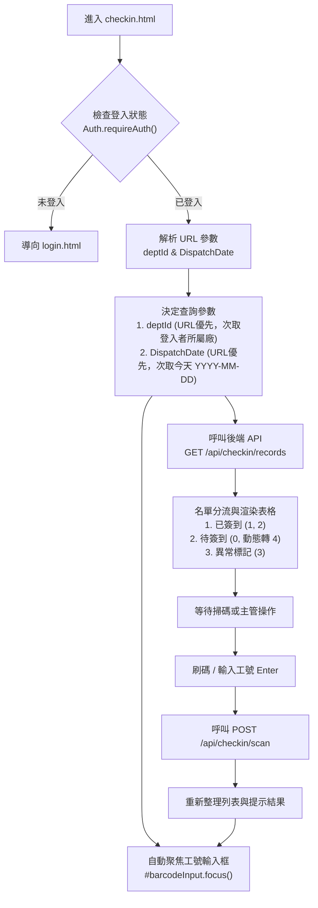

# 現場簽到作業 (checkin.html) 廠別身分帶入、URL 參數解析與簽到 API 串接設計規格

## 1. 概述 (Overview)

本專案針對 CPDS 系統的「現場簽到作業 ([checkin.html](file:///d:/work/CPDS/checkin.html))」進行功能串接與邏輯完善。
實現功能包括：
1. **身分驗證與預設廠別/日期帶入**：進入頁面時讀取當前登入者所屬廠別，並預設載入當日簽到名單。
2. **URL 參數彈性切換**：支援以 URL Query 參數（如 `?deptId=JMB03&&DispatchDate=20261020` 或 `?deptId=JMB03&DispatchDate=2026-10-20`）跨廠切換或查看歷史/特定日期之簽到單。
3. **自動 Focus 體驗**：頁面就緒及每次掃碼輸入完成後，游標自動聚焦於工號輸入框。
4. **精準簽到時間窗口判定**：依據調度時段實施「緩衝區間制」（開始前 10 分鐘 ~ 開始後 10 分鐘為已簽到，開始後 10 分鐘至結束前為逾期簽到，提早超過 10 分鐘或超時則阻擋簽到）。
5. **五大狀態定義**：
   - `0: 待簽到`
   - `1: 已簽到`
   - `2: 逾期簽到`
   - `3: 異常`
   - `4: 已逾期`（僅前端呈現，當日超過結束時間或歷史單據的待簽到者自動標記）
6. **後端 API 與 Demo 備援雙軌支援**：
   - 建立獨立後端路由模組 [routes/checkin.js](file:///d:/work/CPDS/routes/checkin.js)，掛載於 `/api/checkin`。
   - 支援連線真實 LocalDB（操作 `CustCPDSDispatchPlan_Detail` 與 `vw_CPDS_DispatchDetail`）以及離線 Demo 記憶體備援模式。

---

## 2. 系統流程與使用者體驗 (User Flow)



---

## 3. URL 參數與預設值規範 (URL Parameters & Defaults)

- **支援格式**：
  - `checkin.html?deptId=JMB03&&DispatchDate=20261020`
  - `checkin.html?deptId=JMB03&DispatchDate=2026-10-20`
- **解析邏輯**：
  1. 將連續多個 `&` 替換為標準單個 `&`，再由 `URLSearchParams` 解析。
  2. `DispatchDate` 格式相容性：
     - 若為 8 位數字 `YYYYMMDD`（如 `20261020`），正規化為 `YYYY-MM-DD`（`2026-10-20`）。
     - 若為 `YYYY-MM-DD` 則直接沿用。
  3. `deptId`：
     - 若 URL 有指定，使用 URL 值。
     - 若 URL 未指定，讀取登入者物件 `Auth.getUser().deptId`；若仍無則預設為 `JMB03`。
  4. 日期標題顯示：
     - 同步更新頂部藍底列：`{DispatchDate} | {deptName}`。
     - 若取得的是廠別代號（如 `JMB03`），透過 `/api/departments` 或內部對照表轉換為中文名稱（如 `B10-3廠`）。

---

## 4. 狀態代碼與時間窗口比對規則 (Status & Timing Rules)

以調度時段 `StartTime ~ EndTime`（例如 `10:00 ~ 12:00`）為例：

| 狀態代號 | 狀態名稱 | 時間窗口條件 | 畫面徽章樣式 | 資料庫存儲狀態 |
| :---: | :---: | :--- | :--- | :---: |
| **0** | **待簽到** | 調度結束時間前尚未簽到者 | 灰色 `bg-secondary` | `0` |
| **1** | **已簽到** | `StartTime - 10分` 至 `StartTime + 10分`<br>(例: 09:50 ~ 10:10) | 綠色 `bg-success` | `1` |
| **2** | **逾期簽到** | `StartTime + 10分` 至 `EndTime`<br>(例: 10:11 ~ 12:00) | 橘黃色 `bg-warning text-dark` | `2` |
| **3** | **異常** | 主管手動標記為異常者（由待簽到轉入，可填寫異常說明） | 警告 `bg-warning text-dark` | `3` |
| **4** | **已逾期** | **僅前端動態顯示用，不變更資料庫狀態**：<br>1. 若調度日期為過去日期（`< 今日`），待簽到人員一律顯示為已逾期。<br>2. 當日調度時間超過 `EndTime`（例: >12:00）仍未簽到者。 | 紅色 `bg-danger` | `0` (維持不變) |

### 刷碼簽到防呆反饋：
- **重複掃描**：若人員已在「已簽到」清單中 ➔ 提示 `✓ 重複掃描 {工號} {姓名}，已略過`（藍灰提示，不重複送出）。
- **未在調度名單**：若該工號未在當日該廠的調派名單中 ➔ 提示 `✗ 發生錯誤，工號 {工號} 未於調度名單中`（紅色錯誤）。
- **非調度時間窗口**：
  - 提早超過 10 分鐘（如 09:49 前）或超過調度結束時間（如 12:01 後）➔ 提示 `✗ 發生錯誤，{工號} {姓名}，應在 調度時間內 簽到`（紅色錯誤，阻擋簽到）。

---

## 5. 後端 API 規格設計 (`routes/checkin.js`)

所有 API 皆透過 JWT 認證，並自動取得操作人員工號 `req.user.empId`。

### 5.1 `GET /api/checkin/records`
- **Query 參數**：`deptId` (string, 必填), `dispatchDate` (YYYY-MM-DD, 必填)
- **實作邏輯**：
  - **DB 模式**：
    ```sql
    SELECT DetailId, PlanNo, ItemId, DispatchDate, TargetDeptId, TargetDeptName,
           SourceDeptId, SourceDeptName, StartTime, EndTime, Purpose,
           EmpId, EmpName, EmpTitle, CheckInStatus, CheckInTime, CheckInMethod,
           ConfirmUser, ConfirmUserName, AbnormalReason
    FROM vw_CPDS_DispatchDetail
    WHERE TargetDeptId = @deptId AND DispatchDate = @dispatchDate
    ORDER BY StartTime ASC, SourceDeptName ASC, EmpId ASC
    ```
  - **Demo 備援模式**：
    自記憶體 `fallbackCheckinRecords` 陣列中篩選 `targetDeptId === deptId && dispatchDate === dispatchDate`。若無對應日期之資料，自動以預設名單產生供測試展示。
- **回應範例**：
  ```json
  {
    "success": true,
    "deptId": "JMB03",
    "deptName": "B10-3廠",
    "dispatchDate": "2026-10-21",
    "data": [
      {
        "detailId": 101,
        "id": "JM10001",
        "name": "王小明",
        "dept": "A12-2廠",
        "dispatchTime": "10:00~11:00",
        "time": "10:02",
        "status": "1",
        "reasonText": ""
      }
    ]
  }
  ```

### 5.2 `POST /api/checkin/scan`
- **Request Body**：`{ deptId, dispatchDate, empId }`
- **實作邏輯**：
  1. 查找人員紀錄。若不存在回傳 404（未於調度名單中）。
  2. 若已簽到回傳 400（重複簽到）。
  3. 比對當前時間與調度時段：
     - 若不在 `[StartTime - 10分, EndTime]` 區間內，回傳 400（應在調度時間內簽到）。
     - 若在 `[StartTime - 10分, StartTime + 10分]`，判定為 `status = 1`。
     - 若在 `(StartTime + 10分, EndTime]`，判定為 `status = 2`。
  4. 更新資料庫 `CustCPDSDispatchPlan_Detail` 或 Demo 記憶體陣列：
     `CheckInStatus = status`, `CheckInTime = GETDATE()`, `CheckInMethod = 1`, `ConfirmUser = req.user.empId`。
- **回應範例**：
  ```json
  {
    "success": true,
    "status": 1,
    "statusName": "已簽到",
    "checkInTime": "10:02",
    "record": { ... }
  }
  ```

### 5.3 `POST /api/checkin/manager`
- **Request Body**：`{ detailId }`
- **實作邏輯**：主管代簽。
  - 時間判斷同上述，寫入 `CheckInMethod = 2`（主管代簽）、`ConfirmUser = req.user.empId`。

### 5.4 `POST /api/checkin/abnormal`
- **Request Body**：`{ detailId, action: 'MARK' | 'RESTORE', reason?: string }`
- **實作邏輯**：
  - `action === 'MARK'`：更新 `CheckInStatus = 3`, `AbnormalReason = reason || ''`, `CheckInTime = NULL`, `ConfirmUser = req.user.empId`。
  - `action === 'RESTORE'`：更新 `CheckInStatus = 0`, `AbnormalReason = NULL`, `CheckInTime = NULL`。

### 5.5 `POST /api/checkin/abnormal-reasons`
- **Request Body**：`{ items: [{ detailId, reason }] }`
- **實作邏輯**：批次更新異常標記項目的 `AbnormalReason` 欄位。

---

## 6. 前端重構細節 (`checkin.html`)

1. **移除靜態寫死資料**：
   - 將原寫死的 `checkedInData`, `notCheckedInData`, `abnormalData` 改為由 API 動態載入並維護。
2. **初始化管線**：
   ```javascript
   $(document).ready(async function() {
       if (!Auth.requireAuth()) return;
       Auth.renderNavbarUser('#navbarUserArea');
       
       const { deptId, dispatchDate } = parseUrlParams();
       await loadCheckinData(deptId, dispatchDate);
       
       $('#barcodeInput').focus();
   });
   ```
3. **動態逾期計算器**：
   - 擴充 `statusFormatter` 與 `isNotCheckedInExpired`，若 `dispatchDate < today`，待簽到項目一律直接渲染為「已逾期(4)」。
4. **掃碼提交**：
   - 監聽 `#barcodeInput` Enter 鍵或按鈕送出，呼叫 `POST /api/checkin/scan`，依據後端回應即時彈性呈現成功、警告或錯誤 Alert，並重新整理表格且重新自動聚焦。

---

## 7. 測試與驗證計畫 (Verification Plan)

1. **單元測試**：
   - 執行 `scripts/verify_checkin_logic.js` 驗證五大情境的時間切割（09:50~10:10 準時、10:11~12:00 逾期、<09:50 及 >12:00 報錯）。
2. **後端 API 測試**：
   - 啟動伺服器，利用腳本測試 `/api/checkin/records`、`/api/checkin/scan`、`/api/checkin/manager`、`/api/checkin/abnormal`。
3. **前端整合測試**：
   - 測試直接開啟 `checkin.html` 取得登入者廠別與今日日期。
   - 測試開啟 `checkin.html?deptId=JMB03&&DispatchDate=20261020` 是否正確解析廠別與日期並載入名單。
   - 測試掃碼輸入工號與 Focus 保持。
   - 測試歷史日期顯示全部「已逾期(4)」。
