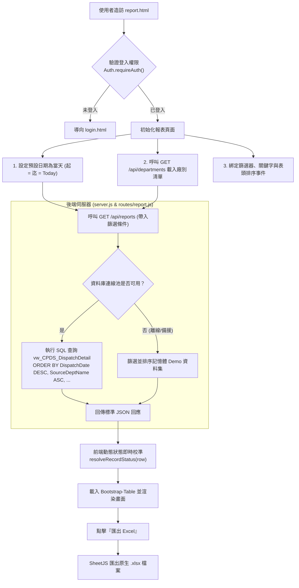

# 跨廠調派明細報表查詢 (report.html) 後端 API 與前端 UI 功能串接設計規格書

- **設計日期**：2026-10-21
- **狀態**：Approved (已定案)
- **目標系統**：CPDS 跨廠人員調度與簽到系統
- **涵蓋範圍**：`report.html`、`routes/report.js`、`server.js`、`scripts/api.js`

---

## 1. 概述 (Overview)

本規格書針對 CPDS 系統之「跨廠調派明細報表查詢頁面 ([report.html](file:///d:/work/CPDS/report.html))」進行完整的前後端 API 串接與功能升級。
主要目標包括：
1. **後端獨立報表 API 模組**：建立獨立路由 [routes/report.js](file:///d:/work/CPDS/routes/report.js)，掛載於 `/api/reports`，查詢資料庫標準檢視表 `vw_CPDS_DispatchDetail`，並支援 LocalDB 連線與離線記憶體 Demo 雙軌備援。
2. **預設條件與動態篩選**：進入頁面預設帶入**當日**之調派單（起訖日期皆為今日），廠別選單由 `/api/departments` 動態取得，並新增關鍵字模糊搜尋輸入框。
3. **嚴格五大狀態定義**：
   - `0: 待簽到`：到調度時間結束前尚未簽到者。
   - `1: 已簽到`：到調度時間開始的前 10 分鐘內簽到者（`StartTime - 10分` 至 `StartTime + 10分` 內簽到）。
   - `2: 逾期簽到`：到調度時間開始超過 10 分鐘後才簽到者（`StartTime + 10分` 之後簽到）。
   - `3: 異常`：主管手動標記為異常者。
   - `4: 已逾期`：到調度時間結束後未簽到者（僅前端顯示用，不更動資料庫狀態，限當天；但若已經過去的日期未簽到者皆顯示已逾期）。
4. **預設排序與欄位手動排序**：
   - 後端 SQL 查詢預設排序為：`調度日期 (DESC, 由新到舊) ➔ 來源廠 (ASC) ➔ 目的廠 (ASC) ➔ 工號 (ASC) ➔ 狀態 (ASC)`。
   - 前端 Bootstrap-Table 支援點擊任意欄位表頭進行即時升冪/降冪排序。
5. **原生 Excel (.xlsx) 匯出**：完全移除 CSV 匯出，使用 SheetJS (`xlsx`) 依當前篩選並渲染完成的表格內容匯出標準 Microsoft Excel 活頁簿檔。

---

## 2. 系統架構與資料流 (System Architecture)



---

## 3. 後端 API 規格設計 (`routes/report.js`)

### 3.1 端點資訊
- **路徑**：`GET /api/reports`
- **認證**：Bearer JWT Token (`req.headers.authorization`)
- **Query 參數**：

| 參數名稱 | 型態 | 必填 | 說明 | 範例 |
| :--- | :---: | :---: | :--- | :--- |
| `startDate` | string | 否 | 調度日期起日 (YYYY-MM-DD) | `2026-10-21` |
| `endDate` | string | 否 | 調度日期迄日 (YYYY-MM-DD) | `2026-10-21` |
| `sourceDeptId` | string | 否 | 來源廠代號，多個以逗號分隔 | `JMA02,JMA05` |
| `targetDeptId` | string | 否 | 目的廠代號，多個以逗號分隔 | `JMB03` |
| `status` | string | 否 | 狀態代號，多個以逗號分隔 | `0,1,2` |
| `keyword` | string | 否 | 模糊搜尋關鍵字 (工號/姓名/單號/備註) | `JM10001` |

### 3.2 SQL 查詢實作規範 (`vw_CPDS_DispatchDetail`)
```sql
SELECT 
    DetailId AS detailId,
    PlanNo AS planNo,
    ItemId AS itemId,
    CONVERT(VARCHAR(10), DispatchDate, 120) AS dispatchDate,
    SourceDeptId AS sourceDeptId,
    SourceDeptName AS sourceDeptName,
    TargetDeptId AS targetDeptId,
    TargetDeptName AS targetDeptName,
    EmpId AS empId,
    EmpName AS empName,
    CONVERT(VARCHAR(5), StartTime, 108) + '~' + CONVERT(VARCHAR(5), EndTime, 108) AS dispatchTimeRange,
    CONVERT(VARCHAR(5), StartTime, 108) AS startTime,
    CONVERT(VARCHAR(5), EndTime, 108) AS endTime,
    CONVERT(VARCHAR(5), CheckInTime, 108) AS checkinTime,
    DisplayStatus AS status,
    DisplayStatusName AS statusName,
    ConfirmUserName AS receiverName,
    AbnormalReason AS anomalyNote
FROM vw_CPDS_DispatchDetail
WHERE 1=1
  AND (@startDate IS NULL OR DispatchDate >= @startDate)
  AND (@endDate IS NULL OR DispatchDate <= @endDate)
  /* 動態組合 SourceDeptId IN (...)、TargetDeptId IN (...) 與 DisplayStatus IN (...) */
  /* 動態組合關鍵字：(EmpId LIKE @kw OR EmpName LIKE @kw OR PlanNo LIKE @kw OR AbnormalReason LIKE @kw) */
ORDER BY 
    DispatchDate DESC, 
    SourceDeptName ASC, 
    TargetDeptName ASC, 
    EmpId ASC, 
    DisplayStatus ASC;
```

### 3.3 離線 Demo 備援機制
- 當資料庫連線未就緒時，後端自動使用內建記憶體資料集，過濾參數並透過 JavaScript 比對與排序（調度日期 DESC ➔ 來源廠 ASC ➔ 目的廠 ASC ➔ 工號 ASC ➔ 狀態 ASC），保證離線展示體驗完整。

---

## 4. 前端 UI 與互動設計 (`report.html`)

### 4.1 多維度條件篩選卡片
1. **調派日期 (起)** (`#filterStartDate`)：初始值為當天日期 (`YYYY-MM-DD`)。
2. **調派日期 (迄)** (`#filterEndDate`)：初始值為當天日期 (`YYYY-MM-DD`)。
3. **來源廠** (`#filterFromPlant`)：Select2 多選下拉選單，由 `/api/departments` 動態載入，value 為 `deptName` 或 `deptId`。
4. **目的廠** (`#filterToPlant`)：Select2 多選下拉選單，由 `/api/departments` 動態載入。
5. **狀態** (`#filterStatus`)：Select2 多選下拉選單（0: 待簽到、1: 已簽到、2: 逾期簽到、4: 已逾期、3: 異常）。
6. **關鍵字搜尋** (`#filterKeyword`)：文字輸入框，支援工號、姓名、調度單號或異常說明，輸入後按 Enter 鍵自動觸發查詢。
7. **清空條件按鈕** (`#btnResetFilters`)：重設起訖日期為「當天」，清空下拉與關鍵字，重新觸發查詢。
8. **匯出 Excel 按鈕** (`#btnExportExcel`)：點擊觸發 `exportToExcel()`。

### 4.2 表格欄位與格式化呈現
表格包含以下 10 個欄位：
1. **調派日期** (`dispatchDate`)：粗體文字，支援表頭排序。
2. **來源廠** (`fromPlant` / `sourceDeptName`)：灰底路線徽章。
3. **目的廠** (`toPlant` / `targetDeptName`)：藍底路線徽章。
4. **工號** (`empId`)：等寬字型。
5. **姓名** (`empName`)：粗體。
6. **狀態** (`status`)：狀態徽章，支援自訂權重排序 (`statusSorter`)。
7. **調度時間起訖** (`dispatchTimeRange`)：等寬小字（如 `10:00~11:30`）。
8. **簽到時間** (`checkinTime`)：等寬小字，無簽到時顯示 `-`。
9. **確認人** (`receiverName`)：文字，未簽到時顯示 `-`。
10. **異常說明** (`anomalyNote`)：若有異常顯示淡紅警示徽章，無異常顯示 `-`。

### 4.3 狀態判定精準邏輯 (`resolveRecordStatus`)
比對每筆資料之狀態：
1. 若 `status === '3'` 或有異常標記 ➔ 回傳 `'3'` (異常)。
2. 若有簽到時間 (`checkinTime`)：
   - 簽到時間超過調度開始時間 10 分鐘以上才簽到 ➔ 回傳 `'2'` (逾期簽到)。
   - 否則 ➔ 回傳 `'1'` (已簽到)。
3. 若無簽到時間：
   - 若調度日期為過去日期（`< 今天`）➔ 一律回傳 `'4'` (已逾期)。
   - 若為當天，且當前時間大於調度結束時間 (`EndTime`) ➔ 回傳 `'4'` (已逾期)。
   - 否則（尚未到結束時間）➔ 回傳 `'0'` (待簽到)。

---

## 5. 原生 Excel 匯出規格 (`exportToExcel`)

1. **依賴模組**：
   - 引入 SheetJS (`xlsx.full.min.js`)。
2. **匯出資料來源**：
   - 透過 `$('#reportTable').bootstrapTable('getData')` 取得當前已篩選、排序且渲染完成之全部資料列。
3. **工作表名稱**：`跨廠調派明細`。
4. **匯出欄位對應**：
   - 調派單號 (`planNo`)
   - 調派日期 (`dispatchDate`)
   - 來源廠 (`sourceDeptName`)
   - 目的廠 (`targetDeptName`)
   - 工號 (`empId`)
   - 姓名 (`empName`)
   - 狀態 (`statusName`，文字呈現：待簽到 / 已簽到 / 逾期簽到 / 已逾期 / 異常)
   - 調度時間起訖 (`dispatchTimeRange`)
   - 簽到時間 (`checkinTime`)
   - 確認人 (`receiverName`)
   - 異常說明 (`anomalyNote`)
5. **檔名命名原則**：`跨廠調派明細報表_YYYY-MM-DD.xlsx`。
6. **自動欄寬計算**：根據內容文字長度動態設定各欄欄寬（!cols），確保於 Excel 開啟時無遮蔽現象。

---

## 6. 測試與驗證計畫

1. **單元與 API 檢核**：
   - 建立檢核腳本 `scripts/verify_report_api.js`，驗證 `GET /api/reports` 之各種查詢條件組合（無條件當日、日期區間、廠別篩選、狀態篩選、關鍵字模糊比對、預設 ORDER BY）。
2. **瀏覽器端綜合驗證**：
   - 進入 `report.html`：確認預設起訖日期為今天，且表格資料預設排序正確（調度日期 DESC ➔ 來源廠 ➔ 目的廠 ➔ 工號 ➔ 狀態）。
   - 測試 Select2 下拉選單：確認來源廠與目的廠正確載入所有工廠，多選能正確過濾資料。
   - 測試關鍵字輸入：輸入工號或姓名按下 Enter，確認表格即時過濾。
   - 測試狀態顯示：確認 0, 1, 2, 3, 4 五大狀態均依規則正確呈現。
   - 測試匯出 Excel：點擊「匯出 Excel」，確認產出 `.xlsx` 檔案，且內容與欄位完全匹配當前檢視結果。
